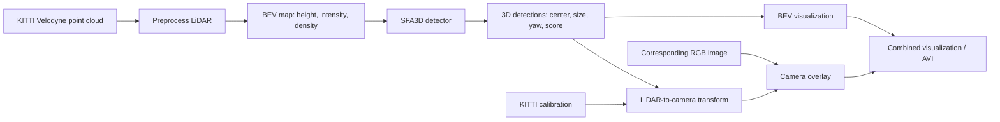

# Real-Time 3D LiDAR-Based Object Detection for ADAS

**Internship project:** 3D perception from LiDAR with Bird’s Eye View (BEV) detection and camera-image visualization, based on the [SFA3D PyTorch implementation](https://github.com/maudzung/SFA3D) and the [KITTI dataset](https://www.cvlibs.net/datasets/kitti/).

> **Repository status — documentation and project foundation.** This repository currently contains documentation only; it does not yet include SFA3D source code, a notebook, KITTI data, model weights, or project-specific runnable scripts. The pipeline and results below are described in the internship project brief and upstream SFA3D materials, not independently verified by code in this repository. See [implementation status](docs/IMPLEMENTATION_STATUS.md).

<p align="center">
  
  
  
</p>

## Overview

This project explores a LiDAR-based perception pipeline for Advanced Driver Assistance Systems (ADAS). The described approach converts KITTI point clouds into BEV maps, runs the SFA3D detector, and visualizes 3D detections in BEV and on calibrated RGB camera imagery. The internship report describes processing front and rear perspectives and creating annotated AVI demonstrations.

The motivation is complementary sensing: LiDAR provides geometric and depth measurements, while camera images offer familiar visual context. This is a perception prototype and visualization project—not a production-ready or safety-certified ADAS system.

## Objectives

- Process KITTI LiDAR point clouds and associated calibration/image data.
- Generate BEV representations for detection.
- Use SFA3D for 3D object detection and estimate bounding-box location, dimensions, heading, and confidence.
- Visualize detections in BEV and project detections onto camera imagery using calibration.
- Explore front/rear BEV views and produce annotated video output.
- Document measurements and limitations so results can be evaluated reproducibly.

## Problem and motivation

Camera-only systems may have difficulty estimating metric depth and can be affected by lighting and visibility. LiDAR captures useful spatial structure but is sparse and has limited semantic information on its own. This project investigates LiDAR-based 3D detection and camera-image overlays as a way to inspect the driving scene and detector output. Sensor visualization is not the same as sensor-fusion inference: the described SFA3D detector operates on BEV LiDAR input; RGB images are used for visualization.

## Features described by the project brief

The items below are **reported project scope**, not verified features in this repository yet.

- KITTI LiDAR point-cloud processing.
- BEV map generation and front/rear BEV visualization.
- SFA3D-based 3D detection using a ResNet-18 feature-pyramid architecture and CenterNet-inspired, anchor-free prediction.
- 3D box attributes including position, dimensions, heading, and confidence.
- Calibration-based LiDAR-to-camera box projection on RGB images.
- Combined visualization and annotated AVI generation.

For upstream implementation details and the actual available commands, see [SFA3D source and execution notes](docs/SFA3D_REFERENCE.md).

## Architecture and processing workflow

The diagram summarizes the project brief and upstream SFA3D design. It does **not** mean these modules are present in this repository.



### Model at a glance

Upstream SFA3D documents a ResNet-based Keypoint Feature Pyramid Network, BEV input encoded from LiDAR height, intensity, and point density, and CenterNet-style center heatmap and regression outputs. The upstream implementation describes anchor-free prediction without NMS. Its KITTI configuration targets cars, pedestrians, and cyclists. Exact project configuration, weights, and modifications must be recorded when source is added; do not assume all upstream defaults match the internship experiment.

## Methodology

1. **Dataset:** Obtain the KITTI 3D object detection data through the official dataset page. It includes point clouds, calibration, images, and labels subject to KITTI's terms.
2. **Preprocessing:** Read LiDAR samples and calibration; validate coordinates, units, and any project-specific filtering.
3. **BEV generation:** Convert points into the model's BEV representation. Upstream SFA3D documents height, intensity, and density channels.
4. **Detection:** Run the configured SFA3D network and decode object centers, dimensions, vertical position, heading, and confidence.
5. **Projection:** Transform 3D boxes from LiDAR to camera coordinates with the sample's calibration before drawing on its corresponding RGB image.
6. **Visualization:** Render BEV boxes and camera overlays; combine outputs and encode video where the selected entry point supports it.
7. **Evaluation:** Record dataset split, settings, hardware, timing scope, and metric definitions. These are currently missing from this repository.

## Dataset and model weights

- **KITTI:** [Official KITTI 3D Object Detection benchmark and download page](https://www.cvlibs.net/datasets/kitti/eval_object.php?obj_benchmark=3d). Download data directly from the official source and follow its terms. Do not commit the dataset to this repository.
- **Expected upstream layout:** See the upstream SFA3D README for its `dataset/kitti/` layout and required `training/`, `testing/`, and `ImageSets/` data. The layout and paths may need configuration for a particular experiment.
- **Pretrained checkpoint:** The upstream project documents a checkpoint under `checkpoints/fpn_resnet_18/`. Obtain weights from the upstream project or the report's stated source, verify provenance and redistribution permissions, and keep large weights out of Git unless there is a clear reason and permission.
- **Data privacy and licensing:** KITTI access and use are subject to KITTI terms. A third-party dataset or checkpoint's terms are separate from this repository's own documentation and any future code license.

## Repository structure

```text
.
├── README.md
├── CONTRIBUTING.md
└── docs/
    ├── IMPLEMENTATION_STATUS.md   repository evidence and verification checklist
    ├── PROJECT_PLAN.md            development and reproducibility roadmap
    └── SFA3D_REFERENCE.md         upstream attribution, dependencies, and commands
```

No empty source modules, placeholder notebook, fake screenshots, dataset, or model weights are included. Add implementation files only when they are available and can be described and tested.

## Setup and execution

### Current repository

There is no runnable project code or dependency manifest here yet, so there is currently no project-specific install or inference command. Do not run upstream commands from this repository and expect them to work.

### Reproducing the upstream SFA3D demo separately

The following commands are from the upstream SFA3D README and apply **after cloning that separate repository**, not to this documentation-only repository. Its pinned dependencies are legacy (for example PyTorch 1.5); use a compatible environment and consult the upstream project before installing on a current Python/Colab runtime.

```bash
git clone https://github.com/maudzung/SFA3D.git
cd SFA3D
python -m venv .venv
# Linux/macOS:
source .venv/bin/activate
# Windows PowerShell: .venv\Scripts\Activate.ps1
python -m pip install --upgrade pip
python -m pip install -r requirements.txt
```

Then, following the upstream instructions, make the required checkpoint and KITTI/demo data available and use its entry point:

```bash
python sfa/demo_2_sides.py --gpu_idx 0 --peak_thresh 0.2
```

For front-view-only demo, upstream also provides:

```bash
python sfa/demo_front.py --gpu_idx 0 --peak_thresh 0.2
```

These are upstream commands; they have not been tested against this repository or a current environment. Check `python sfa/demo_2_sides.py --help`, upstream configuration paths, and its README before running. The upstream script downloads its demo recording, expects its configured pretrained checkpoint, and writes AVI output to its configured results directory. See [reference details](docs/SFA3D_REFERENCE.md).

### Google Colab

A project-specific Colab notebook has not been added. To experiment with the upstream code in Colab, use a GPU runtime compatible with its legacy dependencies, clone SFA3D, install its dependencies, make the checkpoint and permitted KITTI/demo data available, and run the upstream commands above from the SFA3D directory. Validate the runtime/PyTorch/CUDA combination first; do not assume the current default Colab image is compatible. Do not publish credentials or mount/share restricted data.

## Results and performance

The internship report supplied for this project describes LiDAR 3D detections, BEV visualization, 3D boxes, calibration-based RGB projection, front/rear views, and annotated video generation. It reports **approximately 30 FPS on an NVIDIA GTX 1080 Ti**. This figure is an **author-reported result from the project report**, not a benchmark run or independently verified result in this repository. Timing scope, input sequence, exact code revision, and measurement procedure have not yet been recorded here.

The report also mentions a 30% localization-accuracy improvement in earlier project information. The baseline, metric definition, dataset split, and experiment evidence were not provided in the project details currently documented here, so this README does not present that figure as a verified result.

No mAP, accuracy, training, or comparative benchmark figures are claimed here. Add screenshots or videos only from actual project outputs and include data/source attribution.

## Limitations

- This repository currently has no implementation, notebook, tests, or reproducible environment.
- SFA3D is an upstream implementation; the project's exact code revision and modifications must be recorded.
- LiDAR point clouds are sparse, so distant, small, occluded, or partially observed objects can be difficult to detect.
- Camera overlays depend on correct per-frame calibration and coordinate transforms.
- The reported FPS is hardware- and setup-dependent and is not independently benchmarked here.
- KITTI's scope and conditions do not establish reliability for all roads, weather, geographies, or vehicles.
- The project is educational/research work and is not safety-certified for vehicle control or deployment.

## Roadmap

- [ ] Add the actual notebook or source and identify its origin/revision.
- [ ] Record environment, dependency versions, data layout, and checkpoint provenance.
- [ ] Make preprocessing, coordinate frames, and calibration behavior reproducible.
- [ ] Add licensed, representative example visualizations and automated tests.
- [ ] Reproduce the reported runtime and document timing methodology and limitations.
- [ ] Define and reproduce localization metrics/baselines before making comparative claims.
- [ ] Explore camera/LiDAR feature-level fusion and radar integration.
- [ ] Explore multi-object tracking, distant-object performance, and adverse-weather/night scenarios.
- [ ] Evaluate on nuScenes and Waymo subject to their terms.
- [ ] Investigate model optimization/quantization and NVIDIA Jetson or other automotive edge hardware.
- [ ] Explore ROS integration and integration with larger ADAS perception pipelines.

Items above are future work unless explicitly moved to completed with repository evidence.

## References and acknowledgements

- Nguyen Mau Dung, [SFA3D: Super Fast and Accurate 3D Object Detection based on 3D LiDAR Point Clouds](https://github.com/maudzung/SFA3D), including its [technical details](https://github.com/maudzung/SFA3D/blob/master/Technical_details.md). See the upstream MIT license and preserve its copyright/permission notice if redistributing copied substantial code.
- Geiger et al., [KITTI Vision Benchmark Suite](https://www.cvlibs.net/datasets/kitti/).
- Zhou et al., [CenterNet: Objects as Points](https://arxiv.org/abs/1904.07850).
- Park et al., [RTM3D](https://arxiv.org/abs/2001.03343), referenced by upstream SFA3D technical notes for its keypoint feature pyramid design.

## License

No license has been selected for original work in this repository. The upstream SFA3D project has an MIT license, but that license does not automatically license this repository, KITTI data, third-party weights, or other dependencies. See [license status](docs/IMPLEMENTATION_STATUS.md#licensing) before reusing materials.

## Contributing

Issues and pull requests are welcome. Read [CONTRIBUTING.md](CONTRIBUTING.md) and do not submit private data, unlicensed assets, or unsupported benchmark claims.

## Author

**Vivekanand Naik** · [GitHub](https://github.com/vivekanandnaikk) · [LinkedIn](https://www.linkedin.com/in/vivekanand-naik)
